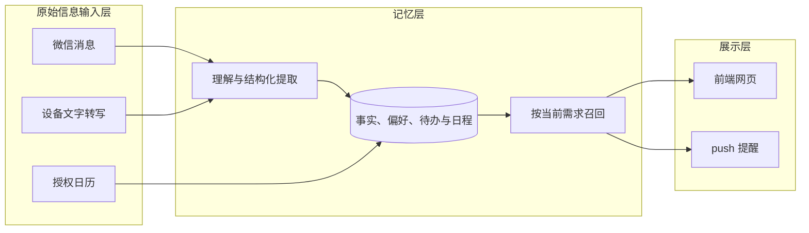

# 个人助理

从聊天、日历和设备输入中整理安排与偏好，在合适的时候提供简报、提醒和建议。

核心思路：**原始信息输入 → 形成记忆 → 按需呈现与提醒**。记忆支撑后续帮助，日常界面聚焦今天的安排、需要处理的事和有用的推荐。

## 产品思路

许多安排是在聊天里逐渐确定的：先讨论时间，后来补上地点，再决定改期。偏好和出行背景也分散在不同对话中。个人助理把这些变化接起来，让待办、日程和建议跟着最新情况更新，减少手动整理和反复解释背景。

产品围绕三个问题展开：**发生了什么、与我有什么关系、现在需要做什么**。提取一条信息只是开始；保留上下文、处理后续变化，并选择合适的呈现时机，才形成持续的帮助。

## 能做什么

- **整理安排**：从微信消息和设备文字转写中提取待办、日程与相关偏好；支持手动补充，以及授权后的 Apple／iCloud 日历导入。
- **汇总当天重点**：每日简报集中展示已有安排，变化提醒合并新增、改期与取消。
- **主动提供建议**：结合明确的个人偏好、行程和日历空档寻找活动或餐厅，说明推荐理由。
- **随时查看和调整**：本地网页与手机入口查看同一份安排，支持完成、取消、改期和推荐反馈；通过微信或本机通知接收提醒。
- **推进复杂需求**：围绕待办整理资料、分析方案和生成草稿，保存进展，补充要求后继续。

## 系统架构

架构按 **原始信息输入层、记忆层、展示层** 划分。新增来源适配输入，新增渠道复用已有结果。



| 模块 | 职责 |
| --- | --- |
| `inputs/` | 接入来源，保留原文、身份和时间；日历等结构化来源直接导入 |
| `memory/` | 理解与保存信息，处理事实时效、用户纠正和相关记忆召回 |
| `presentation/` | 网页展示、用户编辑与 push 投递 |
| `common/` | 各层共用的数据契约、纯函数和模型协议客户端 |

应用入口负责组装各层，后台调度负责检查与投递；简报和推荐组合已有记忆与日程。当前以一个 Python 应用运行，SQLite 保存本地状态。

## 设计取舍

### 原文与理解分开

输入层保留信息本来的来源、说话者和时间，记忆层形成可更新的理解。模型需要区分谁说的话、谁要做的事，以及内容是确认、建议还是转述。自动生成的回复保留为原文，不作为本人的事实或偏好。

### 记忆带着时间与适用范围

工作地点、居住地点和一次出行的目的地各有含义，历史状态也会过期。召回时结合当前行程与问题选择相关信息，保留否定和限制条件；用户纠正优先于自动提取。这样，后续建议能使用当时适用的背景。

### 内容准备与推送时机分开

提取和推荐可以提前准备，投递按日程、时段和消息类型决定时机。耗时的来源检查与投递分别调度；发送状态持久保存，服务重启后仍能继续处理。网页保留完整内容，并用简短状态说明尚未推送的原因。

### 多个入口共用一份结果

网页、手机入口和 push 读取同一份已保存的待办、日程与简报。新信息增量处理，内容未变化时复用已有结果；增加展示渠道时复用业务逻辑，减少重复读取和重复模型输入。

### 保持简单的运行方式

当前规模采用单进程与 SQLite，便于本地运行、维护和备份。模型调用使用现成运行时；公共能力放在 `common/`，业务职责留在各自模块。

## 当前边界

微信、设备最终文字转写和授权后的 Apple／iCloud 日历已支持接入，日历采用单向导入。飞书、原始音频识别和具体音箱的麦克风适配仍待接入。

复杂任务目前用于资料整理、分析和草稿，外部系统操作尚未接入。手机入口与主动提醒依赖主机保持运行和联网。

## 快速体验

需要 Python 3.10+、Git，以及 macOS 或 Linux：

```sh
python3 -m venv .venv
.venv/bin/python -m pip install -e .
.venv/bin/python -m personal_assistant --db ./data/assistant.db serve
```

打开 <http://127.0.0.1:8773/>，即可手动创建待办和日程。本地体验无需配置微信或模型；自动提取、推荐和复杂任务需要安装并登录 Codex CLI，来源和推送按需启用。

## 使用文档

- [使用与部署](docs/usage.md)：来源配置、功能使用、模型接入、微信推送与手机入口。
- [设备接入](docs/device-inputs.md)：配对设备并提交最终文字转写。
- [环境变量示例](.env.example)。

运行数据、聊天记录、凭据与模型运行目录保存在本地，并排除在 Git 外。使用外部模型时，相关内容按功能需要发送给所配置的服务。

本项目采用 [MIT 许可证](LICENSE)。
