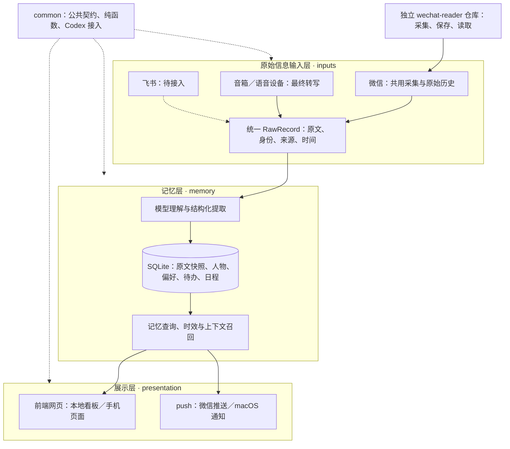

# 个人助理

从微信、音箱等原始信息中整理记忆、待办和日程，再通过网页与 push 提供查看、简报和提醒。架构按 **原始信息输入层 → 记忆层 → 展示层** 组织；当前以一个 Python 应用运行，SQLite 保存本地状态。

## 三层架构



| 层 | 代码 | 职责与边界 |
| --- | --- | --- |
| 原始信息输入层 | `inputs/` | 微信历史、设备转写、连接器分发；保存来源与原始时间，输出统一 `RawRecord`，不判断语义、不发送提醒 |
| 记忆层 | `memory/` | 模型提取、SQLite 持久化、事实时效、用户纠正与相关记忆召回；不依赖网页或 push |
| 展示层 | `presentation/` | 网页、静态资源与 push 投递；读取已保存结果，提交用户编辑，保存投递状态 |
| 公共组件 | `common/` | 来源、身份、时间与 `RawRecord` 契约、纯函数和薄 Codex 协议客户端；供各层与外部消费者使用 |

`app.py`、`followup.py` 等负责应用组装与后台调度，`briefing.py`、`proactive.py` 组合记忆生成简报和建议；它们不代表额外业务层。`common/` 存放三层共用的契约、纯函数和模型协议接入；微信采集、去重、原始 SQLite 保存和只读查询归独立的 [`wechat-reader` 仓库](https://github.com/wq19901103wq/wechat-reader)。`personal_context/` 提供历史／知识适配和跨项目 Python API。`inputs/`、`memory/`、`presentation/` 与 `common/` 直接位于仓库根目录，没有额外的应用包目录。`personal_assistant.py` 是旧命令与导入的兼容入口，业务实现直接依赖各层。

微信作为输入与微信作为 push 输出是两个独立方向：前者通过共用 `wechat-reader` 采集与读取原始历史，个人助理只读消费，后者使用 ClawBot 向本人投递。音箱已支持经过认证的最终文字转写，原始音频识别、具体品牌麦克风适配与飞书连接器仍待接入。新增来源接入 `RawRecord`；新增展示渠道消费同一记忆与业务结果，不复制提取逻辑或另建一份状态。

## 快速开始

需要 Python 3.10+、Git、macOS 或 Linux（使用 `fcntl` 文件锁；原生 Windows 暂不支持）。本库与微信读取库均已公开，源码和依赖可通过 HTTPS 匿名获取，无需 GitHub token。依赖固定到微信读取库的完整提交号，不从 PyPI 查找同名包。以下本地手动待办、日程与网页无需微信、模型或 MAC：

```sh
python3 -m venv .venv
.venv/bin/python -m pip install -e .
.venv/bin/python -m personal_assistant --db ./data/assistant.db serve
```

打开 <http://127.0.0.1:8773/>。在另一个终端可创建待办：

```sh
.venv/bin/python -m personal_assistant --db ./data/assistant.db add '确认项目方案' --due 1d
```

各命令应指向同一个 `--db`；也可设置 `PERSONAL_ASSISTANT_DB`。使用 wheel 安装时请明确指定可写的数据目录，避免使用包安装目录。默认不开启微信投递。

| 能力 | 额外运行条件 |
| --- | --- |
| 读取微信 | 由独立 wechat-reader 或 RPA 采集、且当前用户可读的兼容 SQLite；在“来源”中绑定路径和账号 |
| 读取既有知识 | 显式绑定 DH Share／JSON 或 RPA memory 目录；新库不预设私人知识来源 |
| 模型提取、推荐、记忆问答、复杂任务 | 已安装且登录的 Codex CLI，已验证版本为 0.144.1；不需要 MAC 源码或 Python 包 |
| 微信 push | 已有 ClawBot/iLink 登录，加 `--wechat`；凭据保存在外部私有目录 |
| 手机 HTTPS 入口 | 自有域名、隧道与持续在线的主机；下文安装脚本适用于 macOS launchd |

可参考 [.env.example](.env.example) 配置环境变量。本程序不会自动读取 `.env`；复制后需在启动前执行 `source .env`，或由进程管理器注入环境变量。外部接口私有配置默认在数据库旁的 `integrations.json`，见下文。

## 上传代码与私人数据隔离

`data/`、数据库、日志、凭据、录音、截图、导出、备份、模型运行目录与缓存均排除在 Git 外。把自己的数据和配置放在 `data/` 或仓库外；示例域名、路径与账号均需自行替换。保存过的来源绑定继续保留，新建数据库需自行绑定知识来源。此仓库没有附带个人数据库、登录凭据或模型运行环境。

代码按四库维护：本仓库 `personal-context` 保存个人助理，`wechat-reader` 单独保存微信原始读取能力，`wechat-mac-rpa` 和 `digital-human` 沿用现有仓库。四库均按公开代码库维护；聊天记录、数据库、截图、日志、凭据与个人知识材料保存在本地被 Git 忽略的位置。主项目采用 [MIT 许可证](LICENSE)，微信读取库保留原 RPA 的 MIT 许可与署名。各库依赖与访问条件见 [架构与共用能力](docs/shared-capabilities.md#项目归属与依赖)。

## 已实现

- 来源、账号、会话、消息引用、发送者和时间的公共类型。
- SQLite 只读适配器：列会话、最近消息、跨会话文字搜索、时间筛选和分页。
- DH `observed` 输入转换；共用历史命令，以及 RPA 的 `--history-chat` 草稿入口。
- 共用知识 API 与 `python -m personal_context.knowledge_cli`：读取 DH 原生 Wiki/Share、RPA Wiki 和人工事实/纠正；按人物引用、明确账号或文字查询。
- 从已有微信记录一次提取待办、日程、人物兴趣／地址／偏好，以及匹配新信息的主动建议；原文依据随派生记录保存。
- 本地和手机页面展示日程、待办、简报和推荐；不展示人物画像或历史记忆问答。
- 本人明确偏好与新活动／资料匹配时，通过现有 ClawBot 主动推送。
- 保留后台只读问答接口，按需检索已保存的聊天、待办、日程和绑定知识。
- 助理画像通过同一知识 API 供个人助理、RPA 和 DH 实时能力读取。
- RPA / DH 接入调用链的重复校验清理。
- 个人助理的待办页面、SQLite 状态、到期与定时跟进、关联微信新消息提醒、附来源的本地收件箱。
- 复用现有 ClawBot/iLink 登录，将新提醒推送到本人微信；可选 macOS 通知。
- 微信快捷回复完成、取消、改期；提醒中的手机链接可查看来源和编辑当前待办。
- 详情页提交复杂需求，后台分步推进，保存计划、公开进展和完整结果；补充要求后沿用同一原生线程继续。
- 固定 HTTPS 手机入口，登录自启、进程退出后自动恢复，重启保留任务链接和执行结果。
- 设备最终语音转写入口：本地看板配对、独立接入凭据、稳定事件 ID 去重、原文保存与增量提取；复用现有待办、日程、画像与微信提醒。[设备接入方法](docs/device-inputs.md)。

飞书、原始音频识别、具体品牌音箱的麦克风适配和通用动作工具尚未接入。能提供最终转写的设备或桥接服务可直接使用上述入口。

## 后台只读问答

页面不再展示或自动加载记忆问答。既有只读问答接口和历史数据保留；问答独立保存到同一 SQLite，由 `serve` 后台处理，重启后未完成的问题会继续处理。

问答只读已保存和显式绑定的资料，不自动创建待办或修改记忆，不发送消息。它会按需要查询微信原文，复用本次已读内容；不会每个问题重新提取整份聊天。回答需区分人物身份、历史状态与改期取消，资料不足时说明不足。尚未导入或暂停接入的外部日历不会被自动读取。

问题、回答和模型运行记录保存在被 Git 忽略的本地数据目录。查询内容按需发送给已配置的 Codex 模型。私人手机链接也拥有记忆问答权限，请仅本人使用；单条待办的详情链接不能查询完整记忆。

微信的 `is_self` 仅确认发送账号。输入层根据同会话、相近时间的已发送自动回复记录标记 `authorship=automated`，提取层禁止这些回复新增、替换或撤销人物事实。没有发送元数据的内容保持 `unknown`，不能仅凭账号认定为真人表达；AI 建议、代写和草稿也不当作本人的事实。原始聊天仍然保留。

## 从原始输入到主动帮助

输入适配器输出统一原文，记忆层整理并保存派生信息，网页与 push 读取同一份持久结果。

当前接通微信、待办、日程、兴趣／地址／偏好画像和基于新聊天的建议。打开本地页面，点击“自动关注新聊天”：从启用时开始，每分钟检查当前微信库所有会话的新增活动，包括后来出现的会话；仅变化的会话排队交给模型。未处理队列和检查进度保存在 SQLite，重启后继续。看板显示最近检查、下次检查和读取错误，可停止自动发现。

也可点击“从微信发现”，选择会话和最近 1／7／30 天，或每小时关注所选会话。手动提取默认最近五个会话；每个会话最多读取所选范围内最新 120 条，原始微信库由共用 wechat-reader 保存，既可独立采集，也可由 RPA 调用。自动模式下，启用前记录只作理解上下文，不单凭旧记录创建待办、画像或推荐。重复扫描不重复创建同一原文的待办，已关闭事项不重新打开；资料未变化时跳过模型调用。

自动发现绑定启用时的微信来源与账号，修改默认来源后需重新开启。当前以会话活跃时间变化发现新记录；补录旧时间的记录、修改或撤回可能无法触发扫描，高流量会话超过最新 120 条窗口的部分也可能遗漏。手动提取可用于重新整理已有记录。

```sh
python -m personal_assistant extract --watch-all
python -m personal_assistant extract --chat CHAT_ID --hours 168 --watch
python -m personal_assistant extractions
python -m personal_assistant stop-extraction-watch
```

CLI 提取命令只负责排队，需保持 `serve` 或 `worker` 运行。模型一次返回 `Task / CalendarEvent / ProfileFact / Insight`，助理保存派生数据及必要原文快照。同名人物不自动归并；采集时间不能当作发送时间来推算“明天”。没有可靠日期的期限保留原话供查看。

例如，本人表达喜欢量子计算，后续聊天出现相关活动或资料时，可生成附原文和推荐依据的建议；仅发现兴趣不直接打扰用户，也不会自动把建议建成待办。推荐只使用已确认本人的明确画像，推送不复述具体住址。画像可忽略，建议可标记已读；这两种操作会停止对应尚未发出的推送。

## 按兴趣和日历空档推荐

独立的推荐循环每五分钟检查一次触发时机，使用 Luna medium 实时搜索展览和餐厅。它复用绑定 DH 中本人明确陈述的兴趣、饮食偏好和常用区域，保留日期、时态与证据；不把他人的喜好、一次玩笑或旧住址当作当前偏好、实时位置。

- 临近出行：未来两天有已确认、带地点的日程，寻找目的地的展览或餐厅备选，不假定整天休假。
- 次日有空档：结合地点和空闲窗口寻找适合提前了解、预约的去处。
- 当天有空档：扣除已有日程与交通缓冲，至少有 90 分钟空闲才推荐。

推荐统一从日历计算忙闲，普通日程和重复日程均占用时间；没有安排只表示日历空档，不表示已确认休假。检索可提前为未来空档和出行准备，不受当前忙闲或发送时段限制；自动推送仍在当地 10:00–21:00 内、当前日历没有占用时发送，并避开日程前后各 30 分钟。准备好的推荐保存最早投递时间，忙时等待不消耗微信重试次数，重启后继续等待；到期前没有可发时段就不补发。用户明确要求现在发送时，可立即投递已准备的建议。待办跟进和日程提醒仍按各自设定时间发送。

手机日程与本地看板共用“为你发现”：可暂停推荐，或点击“用当前位置推荐”。定位仅在点击后获取，按约 1 公里精度保存、12 小时有效；未授权定位时使用未来目的地或带日期的历史区域，不声称用户已经在当地。推荐卡片可一键选择“不感兴趣”，持久保存对该去处的反馈，并停止同一名称和地址的未发推荐；换平台链接不会绕过反馈，也不会由一家店推断用户讨厌整个菜系。

记忆按本次行程、推荐类别与文本相关性召回，每次最多 16 条、约 6000 字符，餐饮场景优先保留饮食限制，完整保留否定和限定条件。推荐上下文只展开近期日程，不注入全部聊天或长期重复日程。引用记忆的到期时间会缩短推荐有效期；绑定的 DH 知识文件更新后，尚未发送的旧推荐停止投递。

### 开源项目对照与吸收

| 项目 | 吸收方式 | 本地实现 |
| --- | --- | --- |
| [Mem0](https://github.com/mem0ai/mem0)（Apache-2.0） | 按用途检索相关记忆，限制模型上下文 | `personal_context/recall.py`：字段优先级、词法 BM25 与时间排序；当前未接向量检索 |
| [Graphiti](https://github.com/getzep/graphiti)（Apache-2.0） | 区分事实观察时间和生效时间，旧事实可以失效 | 复用现有 SQLite 时间记忆；`personal_context/memory.py`、`memory/store.py` 衔接 DH 更新和推荐到期 |
| [OpenClaw](https://github.com/openclaw/openclaw)（MIT） | 后台任务准备与消息投递分离，按时机安静运行 | `proactive.py` 研究并持久保存；`memory/store.py` 按日历排队；`presentation/push.py` 通过现有 ClawBot 投递 |

以上为对照后的独立适配实现，没有复制第三方源文件，也没有引入三套存储或运行框架。仍使用现有消息 ID、统一记忆、日历、SQLite 和微信投递队列；个人助理与数字人继续读取绑定的共用事实。`insights` 的 `not_before / occasion_json` 保存投递时机，`place_key / feedback / feedback_at` 保存具体去处及反馈；个人数据仍只保存在 Git 忽略的数据目录。

检索结果保存为现有 `Insight`，附推荐理由和门店详情入口，通过原有 ClawBot 投递。推荐理由解释具体吸引力、与本人需求的关联及值得注意的取舍，不以同城或老字号代替理由。展览核对有效展期。餐饮从日程地点、有效设备定位或历史常用区域选出发点，`maps` 协调层通过 `place_providers` 数据接口查找附近门店，最多并发查询八家门店的实际步行路线、最新及差评样本，再交给模型结合兴趣、行程与网页口碑比较；`places` 只负责结果契约和选择规则，`proactive` 负责时机与流程。选定后复用已查详情；变更出发点则重查路线，避免沿用其他地点的路程。外部接口、坐标转换和缓存收在独立适配器中，后续可替换地图或接入其他数据服务。最多四个候选，不合适或首轮为空时最多再换一批。城市、住宿、门店都来自输入数据，没有单次地点配置。

餐厅口碑优先大众点评，读取不到可用其他平台，不能声称读过未获取的评价。地点、路线和评价分别选择接口，不要求来自同一平台；跨平台按名称、分店、地址和坐标重新匹配，不混用 POI ID。高德官方 Web Service API 提供地点与步行路线，配置 Key 后默认优先使用；无 Key 时保留百度公开网页适配器作为回退，它不是百度官方开放 API。评价可由独立点评 MCP 补充，程序默认合并携程和百度地图的评论。携程自动搜索匹配餐厅详情，每家最多读取三个详情页，再按发表时间读取最新十条评论，选取最新及低分样本；百度地图读取最新及差评样本。合并后优先保留较新评论，最多四条；不保存评论者资料。排除平台生成内容、其他分店及未来日期评论，高德评分不当作评论。评论日期照原始值保存；默认优先参考最近 90 天，未知或较旧时不冒称近期口碑，也不直接淘汰整家店。

日程的标题、地点和说明一起用于确定出发点；住宿已定但会合地点待定时，可使用仍有效的住宿地点。解析后的具体地点会用于下一轮附近查询，出发点变化时重新查询路线。首次候选补齐了新的路线或评论后，在原有最多两轮内重新比较并生成理由，避免只保存数据却仍展示补齐前的结论。评论合并先保留较新的内容，同日期优先大众点评。

接口坐标统一转换到 WGS84，与设备定位计算距离；查询高德路线时转换回 GCJ02。实际步行路线优先采用 30 分钟以内结果；查不到路线用时则只计算 3 公里内直线距离，不推算车程。设备位置约 1 公里精度，路线和直线距离均注明。上述范围可通过 `settings.personalization.place_policy` 的 `review_max_age_days / max_route_minutes / max_straight_line_km` 调整。缺少到店距离、具体吸引力或本次适配理由的候选会自动换店；价格、精确营业时间等未知就省略。位置缓存一天，评论和路线缓存六小时，失败或空结果缓存十五分钟；公共缓存实现只保存归一化必要字段，保存在数据库旁已被 Git 忽略的 `places-cache/`。API Key 不进入结果、用户链接或缓存正文。

### 外部 API、MCP 与 CLI

`integrations.py` 统一读取外部能力配置；`place_providers/` 处理结构化地点与路线数据，`maps.py` 组合地点／路线／评价，`proactive.py` 负责推荐。专用工具优先、网页补充的规则也适用于评价、展览及后续其他来源。MCP 沿用原生 runtime 的 `mcp_servers`，CLI 通过现成 stdio MCP 运行，不另造工具执行循环；仅推荐模块接入这些工具，聊天提取不接入。

| 能力 | 已核实的入口 | 接入条件 |
| --- | --- | --- |
| 高德地点、路线 | [官方 API](https://lbs.amap.com/api/webservice/guide/api-advanced/newpoisearch)、[官方 MCP](https://developer.amap.com/api/mcp-server/gettingstarted) | Web 服务 Key；本项目已实现直接 API 适配器 |
| 百度地图 | [官方 MCP](https://github.com/baidu-maps/mcp) | 百度 AK；与现有公开网页回退分别配置 |
| 大众点评 | [官方 POI 接口](https://poiopen.dianping.com/instructions/markdown/poi.md) | 合作授权，不能当作无需授权的任意门店点评搜索 |
| 大众点评浏览器工具 | [dp-mcp](https://github.com/qianwj/dp-mcp) | 第三方 Playwright 项目，需单独安装并登录；没有复制其源码、自动安装或接管浏览器 |
| 美团 | [官方 MCP 目录](https://developer.meituan.com/ai-hub/mcp-list) | 当前公开目录主要是商家工具，不提供任意餐厅消费者点评搜索 |
| 携程餐厅评论 | [公开餐厅页面](https://you.ctrip.com/food/)及其搜索、按时间排序评论接口 | 当前无需登录；已实现公开网页回退，不是合作方官方 API，也不使用账号 cookie |

私有配置默认读取数据库同目录的 `integrations.json`，也可用 `PERSONAL_ASSISTANT_INTEGRATIONS` 指定。默认 `data/` 已忽略，凭据、登录目录和缓存均放此目录，不提交 Git。例如在已经独立安装、完成登录并构建 dp-mcp 后：

```json
{
  "amap_api_key": "填写自己的 Web 服务 Key",
  "place_providers": {"places": "amap", "routes": "amap", "reviews": ["ctrip_web", "baidu_web"]},
  "mcp_servers": {
    "dianping": {
      "command": "node",
      "args": ["/绝对路径/dp-mcp/dist/index.js"],
      "env": {"DP_PROFILE_DIR": "/绝对路径/data/dianping-profile", "DP_HEADLESS": "true"},
      "enabled_tools": ["check_session", "search_places", "get_place_details"],
      "tool_timeout_sec": 30
    }
  }
}
```

高德 Key 也可由 `AMAP_MAPS_API_KEY` 提供。不填 `place_providers` 时按 Key 自动选择高德或百度网页，评价默认使用 `["ctrip_web", "baidu_web"]`；`reviews` 兼容单个来源名称，也可设为来源数组，单个来源不可用时仍保留其他来源结果。`routes` 或 `reviews` 可设为 `none`。HTTP MCP 原样使用原生配置的 `url / bearer_token_env_var / env_http_headers` 等字段，stdio 使用 `command / args / env / env_vars`，无需再写新适配器。每个推荐 MCP 必须明确列出 `enabled_tools` 的只读工具，未列出则不加载；不可用的 MCP 不阻断其他已接入来源。配置后重启个人助理生效。点评登录到期需要恢复登录，不伪称读取成功。

`python -m personal_assistant integrations` 只读显示选用接口和 MCP 配置状态，不输出凭据，也不把“已配置”当成“已连通”。当前未配置高德 Key 或点评 MCP 时仍走公开网页回退，不能宣称已接通官方高德或大众点评。

后台每个本地日期最多两轮推荐，每轮最多两次候选检索，空结果或失败也计入；同一时机和资料版本不重复自动检索。手动请求独立记录，不受后台日额度限制，也不占用它。候选按模型相关性顺序保留，不按餐厅或展览类别强行排序；补齐资料需要重新比较或不足两项时最多再检索一轮。七天内相同来源链接或标题去重，24 小时最多尝试两条推送、至少间隔四小时。机会过期、日程改动、画像忽略或偏好变更会停止未发出的旧建议；发送中断标记结果未知，不自动重发。没有可靠搜索结果就不生成推荐。候选和未采用原因保存在 `proactive_runs.research_json`，选中门店的出发点、交通、评价与来源保存在 `insights.discovery_json`；本地看板、手机页面和微信共用这些结果。

开发和排查复用正式入口 `python -m personal_assistant recommend --preview`，自动选择当前推荐时机，只输出检索预览，不保存推荐、不推送微信。`python -m personal_assistant recommend` 是手动立即检索并保存，返回本次状态和保存的推荐 ID；添加全局 `--wechat` 后沿用既有微信投递队列及推送时段。后台循环继续受自动检索预算限制。新增能力进入正式模块和自动链路，不写处理单次城市、酒店或门店的临时脚本。预览和运行数据只放 Git 忽略的数据目录。

推荐页面和微信只展示去处、距离／用时、适用日期、推荐理由及门店／活动详情入口；不展示原文证据、DH 线索、检索过程或来源链接清单。这些信息仅供后台处理和排查。

## 每日简报与变化提醒

已有手机日程入口和本地看板首页显示“今日简报”，按当前保存的日程、重复规则与待办实时更新：今天的安排、到期及逾期待办、等待回复和未设期限的事项。日期不明的日程单列为待确认，不当作今天的安排；未知时间和地点明确留空待确认，不从工作地点推断住址或当前位置。每项可直接打开原有编辑入口。

微信每天一份简报，使用已有当地 10:00–21:00 可发送时段，避开普通及重复日程和前后各 30 分钟；不占推荐额度。微信展示各部分数量和前几项，链接可看完整内容。当天没有可发送空档则只在页面保留，不跨日补发。每日推送与变化提醒可在“推送设置与最近记录”分别暂停、恢复。

变化提醒关注未来七天内的日程及当前待办，包括新增、改期、地点调整、取消、删除、完成或期限变化；备注修改和自动跟进时间调整不触发。连续两分钟没有新变化后合并发送，保留原值和最终值，改回原值会撤销尚未发送的提醒。两次简报或变化推送至少间隔 30 分钟，并使用同一发送时段与日历避让规则。首次启用或恢复变化提醒先建立当前基线，不批量推送历史记录。

简报、变化观察状态和投递记录持久保存在 SQLite，重启继续等待；明确失败最多尝试三次，投递结果不明不自动重发，页面显示当前状态。暂停微信推送仍可查看当天简报。变化识别基于已保存的结构化事项；未被来源扫描或提取捕获的聊天修改不会自动成为提醒。

## 日程表

本地看板与私人手机入口共用周日程表：日程显示开始／结束时间、全天和地点；待办按截止日期显示，未定日期的事项留在“待安排”。手机可点选日期查看当天，跨周浏览，手动新建、改期、取消和恢复日程，查看提取依据，并调整待办截止时间与状态。两端使用同一 SQLite 数据库和日程组件。

固定安排使用同一种日程数据的 `recurrence`，支持每天或每周重复、点选星期和可选结束日期。数据库仅保存一条日程及重复规则，按当前浏览范围展开，不预先生成无限记录。编辑、取消、右滑删除均作用于整组，可撤销删除；删除后不会自动补回。若只知道每周天数、尚未确定全部星期，保留待定规则，在“待安排”中补选；日历只展开已确定的星期，推荐同时避开尚可能占用的时间。上班、健身或课程均使用这套通用数据，代码不包含个人作息配置。

在本地页面点击“手机日程 ↗”，或在 ClawBot 微信会话发送 `/日程`，即可获取固定的私人链接 `https://assistant.example.com/calendar/随机令牌`。令牌保存在工作库，重启后不变；链接持有人可以查看和调整个人安排，请勿转发。仅配置 `--public-url` 时提供手机链接。

模型区分待办与时间安排：待办的 `due_at` 是期限，`wake_at` 是下次跟进；日程单独保存 `starts_at / ends_at / all_day / timezone / location`。`scheduled_date / time_period` 保存已确定的日期与时段：例如“11 月 6 日晚上”显示在当天，点开只需补选具体时间，未选择前不编造小时。后续只更新地点或预订进展时保留日期；日期未知才放入待安排。结束时间未知时留空，全天日程的结束采用最后一天的下一天零点；不从采集时间猜相对日期。

提取时单独记录本人在事项中的角色及其原文依据（`involvement`），区分说话者与行动主体。简短同意或建议不能直接当作本人承诺；他人的事项和角色不明确的内容不进入个人待办／日程。用户纠正会随已有事项提供给模型，已纠正记录不再被自动覆盖。

新聊天可引用已有 `task_id / event_id` 更新进展、改期、完成或取消；同一消息可产生多个独立事项，一个事项可积累多条原文证据。已关闭事项不被自动重开，模型等待期间的用户编辑优先保留。完成的提取批次重放不会再次落库。

已确认且时间明确的日程默认在开始前 30 分钟通过 ClawBot 提醒。手机和本地的日程编辑中可调整提前分钟数或关闭，并查看发送状态；全天日程按当地 00:00 计算。待确认、时间待定、已取消或已经开始的日程不推送；电脑恢复联网后，仍未开始且处于提醒窗口内的日程会补发。改期或关闭会停止尚未发出的旧提醒；同一日程同一开始时间只发送一次，发送中断且结果不明时不自动重发。提醒包含开始时间、地点与私人日程链接。

日程提醒复用现有跟进循环与微信登录，投递单独持久保存，不创建伪待办。微信来源读取仍有下述活跃时间和最新 120 条窗口限制。

## Apple／iCloud 日历导入

在 macOS 14 或更新版本上，通过 Apple EventKit 只读导入本机“日历”应用已有的本地、iCloud／CalDAV 和 Exchange 日历；不需要保存 iCloud 密码。先在系统日历中登录账户并等待同步，订阅日历和生日日历不导入。首次使用需安装 Apple Command Line Tools，并在 Mac 上执行：

```sh
python -m personal_assistant calendar authorize
python -m personal_assistant calendar enable
python -m personal_assistant calendar sync
python -m personal_assistant calendar status
```

`authorize` 在忽略的数据目录编译独立读取应用，并弹出系统日历授权。macOS 要求读取已有日程也授予“完整访问”，读取器只调用查询接口。若已拒绝，可在“系统设置 → 隐私与安全性 → 日历”中允许“个人助理日历读取器”，再执行 `sync`。`status` 显示本机权限、日历列表和最近导入状态；`enable --calendar 日历ID` 可重复指定导入范围，不带该参数使用全部账户日历；`disable` 暂停更新并保留已导入内容。后台 `serve` 或 `worker` 沿用同一设置，无需增加常驻服务。

启用后每五分钟读取过去七天到未来九十天的日程，直接进入现有记忆库，不调用模型。改期、地点和状态变化更新原记录，取消及窗口内删除会同步撤下；重复日程由 EventKit 展开，支持单次例外和全天的排他结束时间。首次导入建立变化提醒基线，不把历史导入批量当作新增变化推送。读取失败保留上次内容，不影响其他跟进。

手机入口、本地看板、简报和推荐忙闲共同使用这些日程。Apple 来源标明日历名称，并在原日历中编辑；这是单向导入，助理不会回写。提醒沿用 Apple 日历中最早的至少提前一分钟的提醒；没有这类提醒时不另加默认提醒。生成的应用、授权状态、日历标识及个人安排都只保存在 Git 忽略的数据目录。

## 待办与微信主动提醒

在已安装本包的环境中启动：

```sh
python -m personal_assistant --wechat serve
```

打开 <http://127.0.0.1:8773/>，创建待办、设置期限与下次跟进，或关联一个微信会话。默认每 30 秒检查，未结束任务每天再跟进一次；完成或取消后停止。延后只改变定时提醒，关联会话的新消息仍会触发提醒。

微信推送复用 `~/.mcp-wechat-server/account.json`、`state.json`，也可用 `WECHAT_CREDENTIALS_DIR` 或 `--wechat-credentials` 指定已有登录。目标固定为 ClawBot 绑定的本人账号；关联会话用于读取上下文。推送包含待办标题、原因、期限，以及配置后的手机详情链接。未加 `--wechat` 时只保存本地提醒；`--notify` 可另启用 macOS 通知。

推送与日历同步、聊天读取分别运行，沿用同一进程和 SQLite，无需增加服务。推送循环每五秒检查一次队列（`--interval` 小于五秒时使用该值）；日程提醒优先，各类微信消息每轮最多发送一条，网络请求耗时另计。单路异常不会停止其他推送；独立的发送锁防止后台、手动检查或另一进程同时发送同一条消息。

微信会话过期时，给 ClawBot 发一条消息即可续期；助理收到新会话后，会自动恢复因会话失效而失败、仍有效的推送，包括当天简报，继续遵守原有推送时段和限频，不补发已过期内容。收信在推送循环中执行，游标保存在助理自己的 SQLite，不改 ClawBot 的游标和凭据文件。可重试失败最多自动尝试三次；发送超时或中断时标记“结果未知”，不会自动重发。服务重启后统一恢复中断的发送状态，不盲目补发。“微信接口已接受”表示接口确认接受，不代表本人已读。启用微信后只投递新生成的提醒，不补发旧收件箱。

在 ClawBot 微信会话中发送 `/待办`、`/日程`、`/帮助`、`/完成 12`、`/取消 12` 或 `/改期 12 2h`。`/日程` 返回私人日程链接。改期会同时调整期限和下次跟进，也可写 `2026-11-06T10:00`（待办时区）。引用一条已发送的助理提醒时可省略编号。只处理当前本人在启用收信之后发送的明确命令，普通聊天不做关键词猜测。指令结果和回执一起入库；重复消息不重复修改，回执失败不会重新执行任务。

复杂操作使用手机详情页。配置后的入口形如 `https://assistant.example.com/task/随机令牌`，新微信提醒会使用这个地址。助理通过 launchd 登录自启，进程退出后自动恢复；固定域名复用现有命名隧道，服务或隧道重启后地址不变。任务令牌和执行结果保存在同一 SQLite 工作库。

可选：使用自己的现有 Cloudflare 账号和命名隧道安装（先替换域名和 launchd label）：

```sh
python scripts/install_mobile_service.py --hostname assistant.example.com
python scripts/install_mobile_service.py --hostname assistant.example.com --tunnel-job com.example.cloudflared --apply
```

第一条只在 `data/service/` 生成候选配置；`--apply` 配置 DNS、备份并更新现有 ingress，安装 `com.personal-assistant.service`，然后重启现有隧道，原有路由保留。安装时使用的 Python 必须能运行现有助理。首次接管前须停止手动启动的助理实例，以免占用端口；已安装的同名服务由脚本替换。日志位于 `data/service/assistant.log`，启动配置位于 `~/Library/LaunchAgents/com.personal-assistant.service.plist`。不要同时再手动运行 `serve`。

cloudflared 2026.10.7 的 `auto` 模式在 QUIC 曾连接成功后，不会因后续断线自动切换 HTTP/2。若运行中 QUIC 持续超时，先验证 HTTP/2 可连接，再备份现有隧道配置并将 `protocol` 改为 `http2`，只重启隧道即可；保留全部 ingress，无需重新安装助理或调整 DNS。

网页请求 15 秒超时；刷新逐次执行，连接失败后逐步延长重试间隔，最长一分钟。离线或切到后台时暂停自动刷新，联网或回到页面时立即同步。断线保留已显示的内容和未保存的编辑。保存操作不会自动重发；若未收到确认，先刷新确认结果再决定是否重试。

回滚时用 `launchctl bootout gui/$(id -u)/com.personal-assistant.service` 停止常驻助理，并将其 plist 移出 `~/Library/LaunchAgents/`；若需撤销隧道路由，将安装前的 `~/.cloudflared/config.yml.bak.时间戳` 复制回 `config.yml`，再用 `launchctl kickstart -k gui/$(id -u)/com.example.cloudflared` 加载。工作库和任务令牌继续保留。

详情链接可查看说明、期限、最近十次跟进中的聊天与知识快照，并完成、取消、延后或编辑待办。链接持有人可以操作该待办，请勿转发。公开端口 `8775` 提供单任务链接和独立的私人日程链接；单任务令牌不能访问全日程。私人日程接口提供日程、待办、推荐开关及定位设置，不开放来源配置、完整人物画像或本机管理 API；`8773` 保持本机管理用途。固定入口仍依赖本机联网且已登录，电脑休眠或注销期间不可用。

```sh
python -m personal_assistant add '确认方案进展' --due 1d --wake 1h
python -m personal_assistant wait 1 --until 1d
python -m personal_assistant done 1
python -m personal_assistant inbox --unread
python -m personal_assistant retry-wechat 1
```

默认工作库是 `data/assistant.db`，可用全局 `--db` 改位置。CLI、微信和详情页共用同一工作库，原始微信库和知识文件只读。关闭页面后进程继续工作；电脑休眠期间暂停，恢复运行时补上到期提醒。待办可从聊天自动发现，也可由本地页面或 CLI 补充。

## 复杂任务：计划、进展与结果

在本地待办的“计划与结果”或微信提醒的详情链接中，填写具体需求并点击“开始推进”。助理会读取该任务关联的聊天和已绑定知识，保存分步计划、公开进展与完整结果。完成或需要补充时，沿用原来的提醒渠道通知；在详情页补充要求后继续同一任务线程。新建待办也可勾选“保存后让助理分步推进”。

```sh
python -m personal_assistant add '整理方案与下一步' --chat CHAT_ID --execute
python -m personal_assistant advance 1 '补充要求：按优先级排列，再起草一段回复'
python -m personal_assistant stop 1
```

`serve` 与 `worker` 均启动独立执行队列，模型运行期间仍能查看页面和处理提醒。停止后保留已有进展；服务意外退出时，运行中的执行在下次启动标记为中断，由用户补充要求后继续，避免自动重跑。每轮执行完成与待办关闭分开，是否完成整个待办由用户决定。提醒投递失败只影响通知，不重新执行任务。

首版支持资料整理、分析、方案和草稿，尚未接入浏览网页、向第三人发消息或修改外部系统的工具。结果中的草稿不会自动发送。微信原始记录只限当前待办关联会话，知识只来自创建时绑定的来源；页面保存公开进展，不保存模型内部推理。

信息提取、推荐与复杂任务直接连接 Codex CLI 的原生 app-server，不依赖 MAC。微信聊天和设备转写中的待办、日程、画像与建议提取默认使用 `gpt-6-luna`，可通过 `PERSONAL_ASSISTANT_EXTRACTION_MODEL` 指定；复杂任务的计划与执行默认使用 `gpt-6.1-sol`，沿用 `PERSONAL_ASSISTANT_MODEL` 指定。两者推理强度均为 `medium`，模型配置互不影响。

已验证的协议与 CLI 版本为 `0.144.1`。安装 Node.js 18+ 后运行：

```sh
npm install -g @openai/codex@0.144.1
codex login
```

`CODEX_BIN` 可指定 CLI 路径；`CODEX_HOME` 可指定已有登录目录，默认 `~/.codex`。`common/codex_runtime.py` 只处理 stdio 协议和受限业务工具接入，模型、工具循环、结构化输出及持久线程均由 Codex 原生实现。独立运行目录位于工作库旁的 `runtime/`，仅链接现有登录，不加载全局配置、应用插件和编码工具。登录与模型访问额度由使用者自行提供。

## 安装

Python 3.10+，macOS 或 Linux。历史、知识、待办存储和提醒仅依赖标准库；模型功能另需上述 Codex CLI 和登录。在每个消费者自己的虚拟环境中安装本包。以下命令会通过 HTTPS 自动获取固定版本的微信读取依赖，无需 GitHub 认证：

```sh
.venv/bin/python -m pip install -e /path/to/personal-context
```

离线或联合开发时，先将独立的 `wechat-reader` 仓库检出到消费者所固定的提交，再执行 `.venv/bin/python -m pip install --no-deps -e /path/to/wechat-reader -e /path/to/personal-context`。采集端需另外安装微信读取库的 `[capture]` 依赖；助理只读查询无需这些依赖。

RPA、DH 等消费者需分别在各自的虚拟环境安装本包。调整顶层目录或新增顶层模块后，要在每个消费者环境重新执行可编辑安装；仅更新源码不会刷新安装时生成的模块映射。下面的历史和知识查询使用本包自带的模块入口，不依赖消费者仓库中的本地包装脚本。

## 微信原始消息组件

独立包由 [`wechat-reader` 仓库](https://github.com/wq19901103wq/wechat-reader) 唯一维护，不需要把整个 RPA 做成 submodule。查询只依赖标准库；采集、去重与原始库写入有独立的可选依赖和命令。个人助理与 RPA 固定消费同一个提交；升级时同步修改两库依赖。原有 `wechat-history` 与 `personal_context` Python 导入继续兼容，聊天理解归 `memory/`。

## 读取现有微信记录

在已安装本包的 RPA、DH 或助理虚拟环境中使用：

```sh
.venv/bin/python -m personal_context chats --limit 20
.venv/bin/python -m personal_context recent --chat 'CHAT_ID' --limit 50
.venv/bin/python -m personal_context messages --contains '方案' --limit 20
.venv/bin/python -m personal_context dh-input --chat 'CHAT_ID' --limit 50
```

也可以用 `wechat-history`。输出为 JSON。

数据库默认取 `WECHAT_HISTORY_DB`，其次 `~/wechat-mac-rpa/data/db/chat_history.db`。历史命令的数据源参数放在子命令前：

```sh
wechat-history --db /path/to/chat_history.db --account my-wechat chats --limit 20
```

`--source` 可指定稳定来源标识，默认是数据库文件 URI。单份原始库没有账号列，账号由调用方配置，未配置时为 `unspecified`。

## 读取已有人物与事实

在 RPA 或 DH 仓库调用同一入口；知识来源放在子命令前，显式选择所需文件或目录：

```sh
.venv/bin/python -m personal_context.knowledge_cli --dh-knowledge /path/to/share/SHARE_ID summary
.venv/bin/python -m personal_context.knowledge_cli --dh-knowledge /path/to/share/SHARE_ID people --contains '姓名'
.venv/bin/python -m personal_context.knowledge_cli --dh-knowledge /path/to/share/SHARE_ID facts --person-account 'wxid_example'
.venv/bin/python -m personal_context.knowledge_cli --rpa-memory /path/to/rpa/data/memory --account my-wechat documents --contains '方案'
.venv/bin/python -m personal_context.knowledge_cli --assistant-db /path/to/personal-agent/data/assistant.db facts --contains '兴趣'
```

三个来源参数都可重复并组合使用；`--account` 只绑定所选 RPA 目录，DH 和助理画像从原生记录读取所属账号。`summary` 输出来源和数量，其余命令输出 `usage=current_snapshot` 和 `items`。搜索采用文字子串。

DH 支持 `wiki_structured_v1`、`source_bound_wiki_library_v1` JSON，以及显式指定的 Share 目录。不自动选择最新 Share。人物、属性、关系、事件、称呼、时态、不确定性和证据定位均保留。查询 `--person-account` 只跟随 `exact_account` 身份；同名人物仍是独立记录。

RPA 只读 `wiki/{users,groups,topics}/*.md` 和 `overrides/{aliases,facts,corrections}.json`，不启动 MemoryEngine。人工纠正、人工事实优先于抽取事实返回；Wiki 保持文档形式，沿用运行期去除 `[待验证]` 行的规则，原文件保持原样。别名参与搜索，不据此跨文件合并人物。

这些接口提供当前知识快照，供个人助理和 DH 实时工具调用。DH 生成器原有的按题时间过滤、资料准入和版本绑定继续走原生入口；本次没有把全量快照自动加入生成器。RPA 文件会更新，文件路径与 JSON 数组位置表示本次读取位置，不是不可变历史版本。

```python
from personal_context import open_dh_knowledge, open_rpa_knowledge, open_assistant_knowledge, combine_knowledge

dh = open_dh_knowledge('/path/to/share/SHARE_ID')
rpa = open_rpa_knowledge('/path/to/rpa/data/memory', account_id='my-wechat')
profiles = open_assistant_knowledge('/path/to/personal-agent/data/assistant.db')
knowledge = combine_knowledge(dh, rpa, profiles)
people = knowledge.people(query='姓名')
if people:
    facts = knowledge.facts(entity=people[0].ref)  # 来源 + 页面 + 原生 ID
facts_about_account = knowledge.facts(account='wxid_example')
documents = knowledge.documents(query='方案')
```

事实的 `fields` 保留原生字段，`entity_refs` 指向人物或其他实体，`evidence` 指向原始资料定位。返回顺序表达人工纠正优先级，消费者仍需结合原生状态、有效时间和证据使用事实。

## 用历史记录生成 DH 草稿

RPA 原有草稿客户端新增历史模式，沿用本机 DH 配置：

```sh
.venv/bin/python scripts/digital_human_draft.py --history-chat 'CHAT_ID' --history-limit 50
```

该命令会按既有配置请求模型。输入是 DH 的线上观察格式，RPA 行号不会被当作冻结资料的消息 ID；未知角色、空文本不进入上下文。查看输入可先运行 `python -m personal_context dh-input --chat 'CHAT_ID' --limit 50`。

DH 本地的 `scripts/draft_stdio.py` 历史草稿入口尚未纳入其 Git 版本，不作为公开安装步骤。两个消费者中的 `scripts/wechat_history.py`、`scripts/knowledge.py` 也仍是未跟踪的本地包装脚本；查询请使用上述随包提供的模块入口。

## Python API

```python
from personal_context import HistoryQuery, open_wechat_history
from personal_context.digital_human import recent_draft_input

history = open_wechat_history(account_id="my-wechat")
chats = history.list_chats(limit=20)
chat_id = chats[0].chat_id
page = history.query(HistoryQuery(chat_ids=(chat_id,), limit=100))
draft_input = recent_draft_input(history, chat_id, limit=50)
```

`chat_id` 是来源库中的会话 ID；消息引用包括来源、账号、会话和原始行 ID。时间范围按库内 `recorded_at` 筛选，左闭右开，默认排除撤回消息。

适配器使用 SQLite `mode=ro`，不创建、复制或迁移数据库。每次读取后关闭连接。字段直接映射，没有额外字段校验、schema 预检或游标指纹。

分页游标表示排序位置，继续使用同一查询；较早补录、修改、撤回需要重查相应范围。`recorded_at` 来自 `create_time`，`first_observed_at` 来自 `observed_at`，无法确定的发送时间保持为空。
