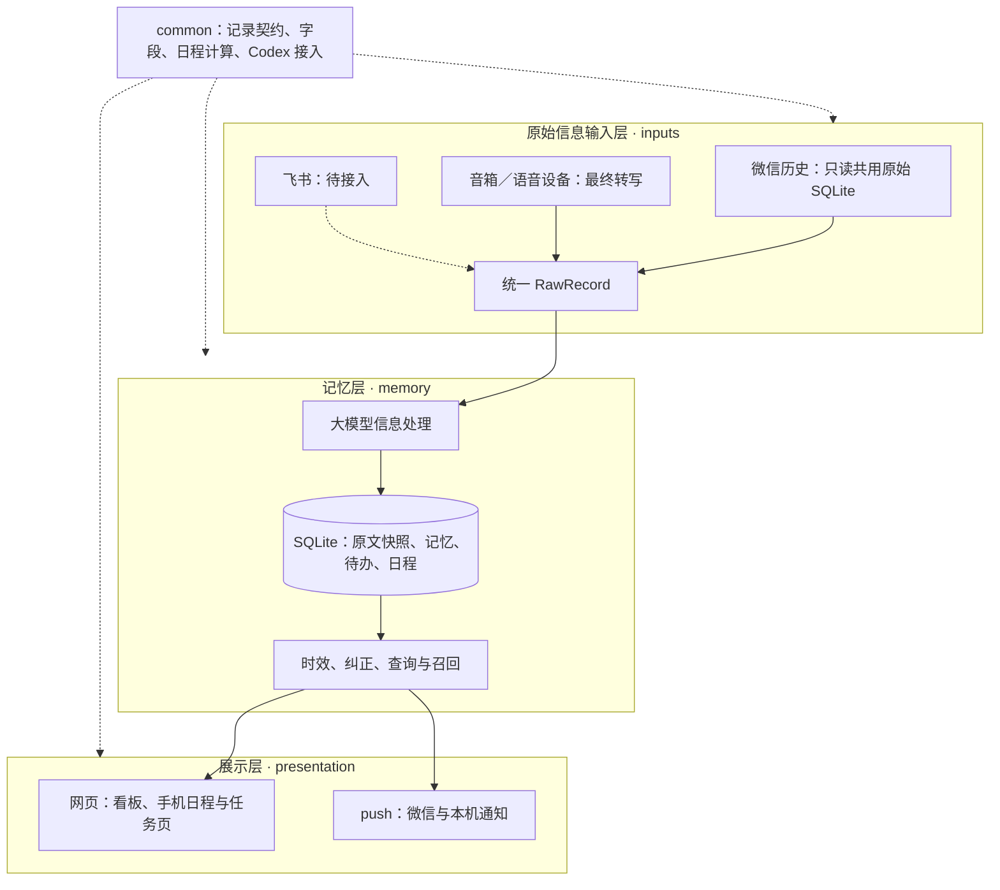

# 个人 Agent、微信 RPA 与 digital-human 的共用能力

更新：2026-11-07。微信历史、设备最终转写、记忆提取、人物画像、相关建议、每日简报与变化提醒、待办跟进和网页／微信交互已实现。飞书、音箱品牌适配及外部动作工具尚未接入。

主链路按三层组织：**原始信息输入层 → 记忆层 → 展示层**。记忆层包含大模型结构化处理、数据库保存、时效管理和查询召回；展示层包含网页和 push。公共契约、纯函数和薄 Codex 协议客户端放在 `common/`。微信手工交办和编辑是补充入口；聊天里发现的承诺、兴趣、地点和新信息才是持续输入。

## Today 调研及产品方向

已阅读 Today 官方产品说明、记忆设计文章及 App Store 介绍，尚未登录试用。下面是公开能力和我们的设计取舍，不能据此断言 Today 的内部实现。

| 官方公开能力 | 我们的设计 |
| --- | --- |
| 记住人物、偏好、项目、目标，跨会话使用 | 原始历史之外，整理有主体、来源和有效时间的长期记忆 |
| 按时间和上下文主动提醒、简报、跟进 | 个人助理保存任务与下次唤醒时间，定时检查到期事项和相关新消息 |
| 多步工具任务及后台执行 | 每次执行保存 Execution、计划和结果，补充要求后沿用原生线程继续 |
| 记忆可以查看、纠正和移除 | 记忆有状态与修订关系；用户纠正保存在记忆层，原始聊天保留原貌 |
| 本机操作依赖设备可用，后台云任务可独立运行 | 微信 UI 动作由本机 RPA 执行，个人助理保存等待和执行结果 |

来源：

- [Today Capabilities](https://today.ai/articles/capabilities)：记忆、主动帮助、工具、多步和后台任务。
- [What Should a Personal Agent Remember](https://today.ai/articles/blog/what-should-ai-agent-remember)：区分上下文、历史、长期记忆和工作状态；记住关系、承诺、偏好、纠正和行动结果。
- [Today 官方 App Store 介绍](https://apps.apple.com/cn/app/today-%E4%B8%AA%E4%BA%BA-ai-%E5%8A%A9%E7%90%86/id6775764827)：项目目标、定时任务、简报、浏览器操作与服务连接。

产品上，个人助理负责“我现在要推进什么”；DH 负责“结合我的知识和表达方式，怎么说”。个人助理需要沟通时调用 DH，需要微信操作时调用 RPA，需要写代码时调用 MAC。

## 项目归属与依赖

| 项目 / 组件 | 持有能力与状态 | 对外提供 |
| --- | --- | --- |
| wechat-reader 独立仓库 | 微信截图/OCR、会话切换、去重、原始 SQLite 保存和只读查询 | 可独立安装的 Python 包与采集／查询 CLI |
| wechat-mac-rpa | 调用共用采集组件；维护回复状态、决策、发送与其他微信操作 | 兼容旧导入和数据库；现有执行入口 |
| 共用包 personal_context | 来源、会话、消息、人物与事实表示；只读历史和知识查询；DH 输入转换 | Python API、历史命令、共用知识命令 |
| digital-human | Share 知识维护与按题检索、persona/style/fewshot、草稿生成、原有 Gen/Judge 流程 | 草稿进程；原生知识供共用适配器读取 |
| 个人助理 personal_assistant | 信息提取、人物画像、主动建议、待办、唤醒时间、跟进快照、执行队列、公开进展、结果、收件箱与投递状态 | dashboard、CLI、微信推送与快捷操作、手机任务详情与补充续跑 |
| ClawBot / iLink | 已有微信登录和本人会话 | 本人微信待办推送，personal_context 提供薄适配器 |
| Codex CLI | 原生模型与工具循环、结构化输出和持久线程 | 助理由 `common/codex_runtime.py` 直接连接 app-server，无 MAC 依赖 |

GitHub 按四库分工：

| 仓库 | 管理方式 | 依赖 |
| --- | --- | --- |
| `personal-context` | 公开的个人助理独立库 | 固定提交的 `wechat-reader`；可选读取 DH／RPA 的私有知识 |
| `wechat-reader` | 公开的原始采集与读取独立库，保留 MIT 署名 | 查询仅标准库；采集依赖通过 `[capture]` 安装 |
| `wechat-mac-rpa` | 保留现有公开库与历史 | 与助理使用相同提交的 `wechat-reader`；DH 仍走既有草稿子进程 |
| `digital-human` | 保留现有公开库与历史 | 不新增采集职责；实时历史模式可选安装 `personal-context` 及其读取依赖 |

`wechat-reader` 源码只在独立库维护，消费者不保留副本或整个 RPA submodule。助理的 `pyproject.toml` 与 RPA 的 `requirements.txt` 使用相同完整 Git 提交号；升级时一并更新。包未发布到 PyPI，仓库公开后依赖通过 GitHub HTTPS 地址安装，无需 GitHub token。RPA 的 GitHub Actions 与外部 fork 使用相同的匿名安装方式。目前助理和读取库尚未公开，发布需先公开读取库中的固定提交，再公开依赖它的助理版本；此前使用本地源码或 wheel。四库只公开代码与通用样例，聊天记录、数据库、截图、日志、凭据和个人知识材料继续留在本地被 Git 忽略的位置。

模型提取、推荐和复杂任务直接连接已登录的 Codex CLI，已验证版本为 `0.144.1`，安装和登录步骤见 README。薄协议客户端在 `common/codex_runtime.py`，没有 MAC 导入或本机源码目录依赖。历史／知识查询、手动待办、日程和本地网页无需模型即可使用。

每个消费者使用自己的解释器与环境；离线联合开发可安装已检出的本地源码或 wheel。仓库拆分不迁移原始库、不改变服务配置，已安装 wheel 的采集服务继续运行。数据、凭据、日志、截图和备份都留在被 Git 忽略的本地位置。

飞书到统一记录的虚线表示待接入；`common` 的虚线表示共用依赖。原始微信库由独立 `wechat-reader` 采集器或 RPA 调用同一组件写入，一次只运行一个采集所有者；其他消费者只读。助理库保存派生信息与必要原文快照。画像和相关新信息在同一模型处理阶段匹配，不需要再造一套推荐 Agent。DH 保留独立解释器和子进程，避免两个项目的 `src` 包互相覆盖。

采用 Python 包、SQLite 和已有子进程。本地 HTTP 提供个人助理页面，提醒、信息提取与复杂任务使用独立后台 worker；原生 Codex runtime 负责模型与工具循环。不增加跨项目 HTTP/MCP 层、消息总线或通用 Agent 基类。

## 本轮已经接通

`personal_context` 提供历史与知识适配的 Python API，依赖 Python 3.10+ 标准库。RPA、DH 等消费者可在各自虚拟环境安装本仓库；历史和知识查询使用随包提供的模块入口。

| 入口 | 实际用途 |
| --- | --- |
| 共用 `wechat-history` / `python -m personal_context` | 列会话、读最近消息、跨会话文字搜索、时间范围和分页、导出 DH 输入 |
| RPA `scripts/digital_human_draft.py --history-chat …` | 从原始库读取上下文，调用既有 DH 草稿客户端 |
| 共用 `python -m personal_context.knowledge_cli` | 查询当前知识快照中的人物、结构化事实和 Wiki 文档 |
| `python -m personal_assistant --wechat serve` | 本地待办页面与跟进进程，使用同一历史/知识 API，向本人微信推送提醒 |
| 手机任务页 / `personal_assistant advance ID '需求'` | 后台分步执行，保存公开计划、进展、结果和补充问题；沿用原生线程继续 |
| dashboard“从微信发现” / `personal_assistant extract` | 从保存的聊天提取待办、人物兴趣与地点，结合新内容发现相关建议，可每小时自动扫描 |
| `knowledge_cli --assistant-db …` / `open_assistant_knowledge` | 把助理画像映射为同一人物与事实 API，供多个项目读取 |

两仓的 `scripts/wechat_history.py`、`scripts/knowledge.py` 和 DH 的 `scripts/draft_stdio.py` 仍是未跟踪的本地文件，不作为公开版本的安装入口。历史与知识查询分别使用上表中的模块；DH 草稿历史模式尚未纳入其 Git 版本。

RPA 草稿入口使用 `--history-db`、`--history-account`、`--history-source` 和 `--history-limit`。独立历史查询使用 `--db`、`--account`、`--source`。数据库默认取 `WECHAT_HISTORY_DB`，其次 `~/wechat-mac-rpa/data/db/chat_history.db`。

历史适配器使用 SQLite `mode=ro`，每次读取后关闭连接。未复制微信库、创建服务或导入 DH 训练材料。草稿命令会按既有配置请求模型；本轮接入验收只读取记录和生成输入，没有运行真实生成。

知识适配器只读原生文件或助理数据库，不导入两仓的 `src` 包。`open_dh_knowledge(path)`、`open_rpa_knowledge(path, account_id=…)` 与 `open_assistant_knowledge(path)` 都返回 `KnowledgeReader`；`combine_knowledge` 组合显式选择的来源，提供 `people / facts / documents` 查询。无需初始化 DH 的冻结 case 或 RPA 的后台记忆 worker。

## 数据模型

### 1. 原始证据：已经实现

| 类型 | 关键字段 / 引用 | 含义 |
| --- | --- | --- |
| SourceBinding | `source_id, account_id` | 一份来源及其所属账号 |
| HistoryChat | `source, chat_id, display_name, chat_type, last_active_at` | 来源中的会话 |
| MessageRef | `source, chat_id, message_id` | 可跨项目保存的原始消息引用 |
| HistoryMessage | `ref, sender, time, content, message_type, image_description, is_revoked, source_file, source_content_hash` | 原始内容和来源信息 |
| SenderEvidence | `source_sender_id, display_name, identity_basis, is_self` | 来源中能观察到的身份信息 |
| MessageTime | `recorded_at, first_observed_at, sent_at` | 库内时间、首次观察时间、可靠发送时间 |
| RawRecord | `id, source, stream_id, kind, actor, time, text, content_hash` | 连接器交给信息处理层的统一输入；微信、飞书、音箱共享此结构 |

单份 RPA 数据库没有账号列，账号由配置绑定。消息唯一引用是 `(source_id, account_id, chat_id, message_id)`，其中 `message_id` 是 RPA SQLite 行号，不能当作 DH 冻结资料的消息 ID。

`create_time` 映射为 `recorded_at`，`observed_at` 映射为 `first_observed_at`；无法确定发送时间时 `sent_at=None`。`_sender_昵称` 是昵称占位，不能自动当成某个稳定人物身份。历史覆盖程度未知，返回 `coverage=unknown`。

`recent_draft_input()` 输出 DH 现有的 `kind=observed` 上下文，携带本人角色和 `time_basis`。原始 RPA 行号不会被塞进 DH 的历史身份字段；空文本和角色未知消息不进入生成上下文。调用方仍可通过共用历史 API 保存原始消息引用。

### 2. 已有知识的共用读取：已经实现

| 类型 | 字段 | 用途 |
| --- | --- | --- |
| KnowledgeRef | `source, document_id, record_id` | 来源与账号、页面、原生记录 ID；不靠昵称统一身份 |
| KnowledgeEntity | `ref, kind, name, account, identity_status, fields, evidence` | 人物及群、机构等实体；保留原始字段与身份状态 |
| KnowledgeFact | `ref, kind, entity_refs, fields, evidence, authority` | 属性、关系、事件、称呼、人工事实和纠正；主体/对象方向、时态及不确定性留在原生 fields 中 |
| KnowledgeEvidence | `ref, locator` | 原证据 ID 和路径、消息 ID、时间、账号及已有哈希；不重新读取原消息或计算哈希 |
| KnowledgeDocument | `ref, title, kind, format, text, entity_refs` | RPA Wiki 文档；保留文档性质，不自动提升为结构化事实 |

DH 原生单页 `wiki_structured_v1` 与库 `source_bound_wiki_library_v1` 都可读取。Share 目录只取 `content/library.json` 或 `content/knowledge.json`，版本由调用者明确选择。跨页相同原生账号可用 `facts(account=…)` 查询，但只有原生 `exact_account` 身份参与；未确认同名实体仍按完整 KnowledgeRef 区分。人物查询返回原始人物记录，数量不等于已归并的真人数。

RPA 读取三类 Wiki 与现有 aliases/facts/corrections，不实例化 MemoryEngine。文件名与别名只构成昵称占位，不绑定到 wxid。人工纠正优先于人工事实，人工事实优先于抽取事实；不擅自覆盖其他来源中的矛盾事实。Wiki 文本沿用 RPA 运行期隐藏 `[待验证]` 行的规则，源文件不变。人工事实/纠正证据使用文件路径和 JSON Pointer；这是本次快照的定位，数组移动或文件改写后不代表历史版本。

这层不替代 DH 的历史按题准入，也没有自动改变生产生成器绑定。DH 的 `knowledge_view`、WikiLookup、WikiLibrary 与冻结 runtime 继续留在原项目；共用层仅映射原生数据。个人助理可直接用同一 API 读取这些已有知识，实时消费者按原生状态和时效选择内容。

### 3. 待办与跟进：已经实现

工作状态保存在 `data/assistant.db`，不修改原始历史和知识文件。

| 表 | 核心字段 | 用途 |
| --- | --- | --- |
| tasks | `id, description, notes, status, due_at, wake_at, timezone, followup_seconds, scope_json, observed_json, revision` | 待办、下次跟进、固定来源和会话、最近消息基线 |
| runs | `id, task_id, trigger, context_json, created_at` | 跟进快照，保存相关聊天、知识和原始引用；执行通知只引用对应 execution_id |
| reminders | `id, task_id, run_id, title, body, read_at, notification_status, notification_attempts` | 本地收件箱和独立的 macOS 通知状态 |
| wechat_deliveries | `reminder_id, recipient_id, bot_id, client_id, status, attempts, error, retry_at, provider_message_id` | 微信目标、持久化调用标识和投递结果；不保存登录密钥 |
| wechat_commands | `bot_id, recipient_id, message_id, task_id, command, reply, client_id, status` | 本人明确指令的去重、处理结果和独立回执队列 |
| task_links | `task_id, token` | 单任务详情与操作的随机链接 |
| task_threads | `task_id, thread_id` | 一个待办对应一个原生 Codex 线程 |
| executions | `id, task_id, instruction, status, plan_json, result, question, error, stop_requested, created_at, started_at, finished_at` | 一轮具体需求的排队、执行与终态；独立于提醒快照 |
| execution_events | `id, execution_id, kind, text, created_at` | 对用户公开的计划更新、进展与来源读取记录，不保存内部推理 |
| settings | `key, value` | 默认来源与时区；助理自己的微信收信游标、启用时间和当前会话 |

`due_at` 是约定期限，`wake_at` 是下次定时跟进。任务状态为 `open / waiting / done / cancelled`。默认未结束任务每天跟进；完成、取消停止。创建时绑定来源和会话，新库只提供微信历史路径的通用默认值，DH 与 RPA 知识来源默认为空，必须显式绑定；已有数据库保存的来源设置继续保留。可在页面修改新任务的来源。

关联会话每轮重查最近 30 条消息，按完整绑定与原生 ID 比较，只有明确来自他人的新增消息触发；本人或身份未知消息不触发。新消息不自动完成任务，也不改变定时安排。来源不可读时仍保留待办与定时提醒。没有全量抽取或可靠变更日志，重查窗口之外的新增、补录、修改、撤回可能遗漏。

跟进时按明确关键词或账号读取已有知识，聊天和知识来源随 Run 留在本地收件箱。任务状态、下一次唤醒、Run、Reminder 和微信排队在同一 SQLite 事务中保存；现有进程文件锁避免重复 tick，revision 避免旧检查覆盖用户编辑。

微信使用现有 ClawBot 的 `~/.mcp-wechat-server` 登录，仅与登录绑定的本人交互。提醒包括标题、原因、期限、任务 ID 和配置后的手机详情链接。收信并入同一跟进循环，在助理 SQLite 中保存自己的游标，不修改 ClawBot 凭据和外部游标。仅处理首次启用之后的本人明确命令：`/待办`、`/日程`、`/帮助`、`/完成 编号`、`/取消 编号`、`/改期 编号 2h`。`/日程` 返回固定的私人日程链接。引用已投递的助理提醒可省略编号，普通聊天不做关键词路由。任务修改、消息去重、回执排队和游标推进在同一事务完成；回执失败不重跑已处理任务。登录绑定改变时旧队列不会转发给新账号。

交互采用微信与网页组合：微信负责触达和快捷操作；手机详情页负责说明、时间、跟进来源、较完整的编辑，以及复杂任务的计划、进展、结果和补充要求。页面通过独立 HTTP 端口和固定 HTTPS 域名 `assistant.example.com` 提供。`/task/{token}` 只对应一个 Task；`/calendar/{token}` 使用另一个独立令牌，可查看和调整个人日程与待办。私人日程 API 仅投影必要字段和对应原文，不提供来源配置、画像或本地管理接口，也不接受复杂任务执行命令。网页、微信和 CLI 复用同一 TaskStore，无需同步另一份业务状态。链接持有人可以操作对应内容。

手机入口可复用用户自己的 Cloudflare 命名隧道，增加独立域名到 `127.0.0.1:8775` 的路由；现有其他项目路由保留。`scripts/install_mobile_service.py` 生成配置，`--apply` 备份并安装；助理由 launchd 登录自启、退出后自动恢复，隧道沿用已有常驻服务。SQLite 中的令牌、线程和执行结果不会随重启更换。部署与回滚见 README，日志为 `data/service/assistant.log`。运行依赖本机联网且已登录，休眠或注销期间入口暂停。

微信投递状态是 `pending / sending / delivered / retry / failed / unknown / superseded`。`delivered` 代表接口确认接受。明确可重试失败间隔 60 秒，最多三次；超时、异常响应或发送中断标为 `unknown`，不自动重发。已读或编辑任务取消未发提醒，发送已开始时不能撤回。失败可从页面重试；会话过期需要先给 ClawBot 发消息。默认不启用外部通知，`--wechat` 启用新提醒的微信投递，`--notify` 独立启用本机通知。

待办优先从聊天自动发现，也可通过本地页面或 CLI 补充；完成、取消和改期可通过微信或手机详情页。提取待办在本地保留来源关联，用于记忆更新；手机详情页展示安排与操作。新建时可要求执行，也可在详情页或 CLI 提交后续需求。进程运行时才提取、跟进和执行，电脑休眠会暂停，恢复后处理到期任务。

复杂任务通过共用协议客户端连接 Codex 原生 app-server，一个 Task 对应一个原生 thread，每轮用户需求对应一条 execution。SQLite 队列串行消费，单任务最多一个排队或运行项；提醒 worker 独立运行。模型通过 `report_progress` 和原生计划事件更新公开计划，通过受限工具读取当前任务绑定的微信会话与知识来源，自行决定分步方式，不设固定角色流水线。

执行状态为 `queued / running / completed / needs_input / failed / interrupted`。`completed` 表示本轮需求已完成，不自动把 Task 标为 done；`needs_input` 保存具体问题，在同一详情页补充后续跑同一原生线程。停止会中断本轮，保留已有进展。服务重启将遗留 running 标为 interrupted，queued 继续排队，已完成业务不自动重跑。结果、终态、提醒和微信 outbox 一起提交，通知失败只重试投递。

首版原生线程只开放公开进展、关联聊天和知识读取工具，支持整理、分析、方案和草稿。编码工具、全局应用插件、网页搜索未开放，也没有第三人消息发送工具。执行目录与 Codex home 在工作库旁单独保存，只复用已有登录；运行配置见 README 的“复杂任务”。

### 4. 信息提取、画像与主动建议：已经实现

同一个处理阶段输出待办、日程、画像和建议，整批保存到个人助理 SQLite。原始信息不直接驱动发送；模型只输出结构化结果，没有工具和发送权限。

| 表 / 类型 | 关键字段 | 用途 |
| --- | --- | --- |
| history_scans | `source_key, scope_json, hours, status, result_json, error` | 固定来源与范围，保存提取进度和结果 |
| history_scan_state | `source_key, signature` | 每条原始记录的内容签名，未变化时跳过模型 |
| task_origins | `source_key, message_id, task_id` | 兼容旧单锚点映射，新数据使用 extraction_items |
| extraction_items | `source_key, anchor_id, kind, item_key, item_id` | 新建事项重放映射，允许同一消息多事项；语义关联由模型返回已有 ID |
| item_evidence | `kind, item_id, source_key, record_id, content_hash, record_json` | 事项与消息多对多，保留证据内容及版本 |
| profile_facts / ProfileFact | `account_key, subject_key, subject_name, identity_basis, is_self, category, value, confidence, evidence_json, status` | 人物兴趣、地址／常用地点与偏好，保存原文、主体和明确／推断状态 |
| insights / Insight | `source_key, anchor_id, title, body, reason, profile_ids_json, evidence_json, notification_status, client_id, recipient_id, bot_id` | 画像与新活动／资料匹配的主动建议、原文和独立投递状态 |
| calendar_events / CalendarEvent | `id, title, notes, scheduled_date, time_period, starts_at, ends_at, all_day, timezone, location, time_text, status, recurrence_json, remind_before_minutes, scope_json, updated_at, revision` | 单次或重复时间安排；日期与时段可先确定，具体时刻待补；默认提前 30 分钟提醒，null 关闭 |
| event_reminders | `event_id, starts_at, remind_before_minutes, client_id, recipient_id, bot_id, status, attempts, retry_at, error, sent_at` | 日程与开始时间唯一；复用跟进循环和 ClawBot，改期／取消停止待发，重启不盲目重发 |

事项的 `scope.involvement` 保存本人角色、确认状态与依据消息，消息发送者不等同于事项行动主体。只有本人角色明确的事项才进入待办和日程。`scope.user_correction` 保存用户纠正并优先提供给模型，自动提取不覆盖该事项。

待办更新返回 `task_id`，日程更新返回 `event_id`，只能引用本次提供的同账号事项。每种事项至多提供 120 条候选，优先当前会话及近期更新。新消息明确改期、完成或取消时更新原 ID；新建记录用消息锚点与标题作重放兜底，不能以相似标题代替语义判断。用户编辑期间 `updated_at` 已改变则跳过旧模型更新；已完成／取消状态不被模型重新打开。整批已完成则直接返回保存结果。`item_evidence` 保留后续聊天依据，不受旧单消息映射限制。

待办期限使用 keep / set / clear，未提及期限时保持原值；日程时间同样明确区分保持、设置和待定。日程结束未知不编造时长，全天结束时间排他，无可靠日期放入待安排。周日程表同时展示时间安排与待办截止，本机管理页和私人手机页共用组件，手机按日查看、跨周切换，支持日程新建、改期、取消、恢复，以及调整待办。令牌随工作库持久保存，微信 `/日程` 或本地“手机日程”可获取。微信日程提醒复用 ClawBot，系统日历同步尚未接入。

固定行程只是 `CalendarEvent` 的重复规则，API 字段为 `recurrence`：`frequency` 为 daily 或 weekly，weekly 使用 `weekdays`（周一为 0），可选 `until` 包含结束当天。仅知道每周天数时保存 `weekly_count`，尚未确定的星期保留待定。数据库保存整组，按请求日期范围展开 occurrence；日历和提醒只使用已确定的 occurrence，推荐忙闲还避开未定星期的潜在占用。编辑、取消和删除均作用于整组；没有个人作息默认值或启动时自动补回逻辑。

人物身份使用来源、账号和原始发送者证据；昵称占位只在当前会话内使用，不能跨会话自动归并。本人只依据 `is_self=true`，不按昵称猜。画像分为 `interest / address / preference`，明确表达与推断分别保存。提到地点不等于居住在那里，临时活动地点不作为地址画像。用户可忽略画像；忽略后共用知识 API 不再返回，也停止尚未发出的相关推荐。

提取默认最近五个会话，可选择一至十个会话及最近一至三十天，每个会话读取最新 120 条。可选每小时扫描已选会话，或从启用时开始，每分钟发现全部会话的新活动（包括新会话）。自动模式绑定当时的来源与账号，持久保存会话活跃时间快照；快照推进与扫描入队同一事务，正在提取时到来的活动留待下一轮，重启后继续未处理队列。检查调度与模型执行分开，模型忙时新扫描在 SQLite 排队。启用前记录仅作上下文，自动产生的待办须有新证据、画像须来自新表达、推荐须有新机会。

当前依据 `last_active_at` 变化发现活动，补录旧时间记录、修改或撤回可能无法触发；超过最新 120 条窗口的记录可能遗漏。一次原生模型调用输出 `tasks / events / profiles / insights / summary`；证据只能引用本批原始记录，整批候选构造后事务落库，不部分保存。模型失败保存错误，可重新提取。没有可靠发送时间时，“明天／周五”保留原话，不从采集时间猜日期。

聊天匹配推荐只使用已确认本人的明确画像，还需本轮新增或修改的信息作为独立机会证据。例如本人喜欢量子计算，新聊天出现相关讲座或资料，才生成推荐；仅提取兴趣不发提醒。不编造 URL、活动或日期，也不把推荐自动变成待办。

另有按时机工作的推荐循环：未来两天的明确出行，或当天／次日日历有空档时，用 Luna 实时搜索展览和餐厅。可在当前忙碌或发送时段以外提前准备；发送时再判断当前是否适合打扰。上下文读取绑定 DH 中以本人为主体的明确属性，结合其日期、时态、行程目的地与用户主动提供的有效定位。空日程不等于休息，历史地点不等于 GPS。手机入口可开启或暂停推荐、提供大致位置，详情与来源链接沿用现有页面。

`settings.personalization` 保存推荐偏好、有效定位及通用地点筛选策略，时间占用统一来自日历；`proactive_runs` 保存每轮时机、日期、上下文版本和结果，空结果也持久记录。`insights` 增加 `kind / url / expires_at / context_json`，继续使用原投递队列。每天最多两轮推荐，七天内同链接或标题不重复推荐；保存及投递前按当前日程、画像和设置判断旧机会是否仍有效。

自动地点推荐分为语义检索与确定性选择：输入的地点引用只能来自本轮日程、定位或历史事实，日程备注保留具体场所信息；Luna 通过实时搜索输出出发点和最多四个具体候选，餐厅附地址、带来源的路线或坐标、带评论日期的平台评价、具体吸引力、适配理由和取舍。`places.select_candidates` 计算同坐标系直线距离，按评价新鲜度与出行成本筛选，不把同城当作附近，不用几何距离猜车程。缺关键依据时，在同一轮内最多换一批候选；两次检索共用原有轮次预算和机会过期时间，没有无界重试。

`proactive_runs.research_json` 保存原始结构化候选、未采用原因和本轮策略；`insights.discovery_json` 保存选中门店的 `origin / address / coordinates / travel / reviews / attraction / fit / tradeoff / target_date / researched_at / sources`。推荐正文根据这些字段生成，页面与微信消费同一记录，只展示去处、距离／用时、适用日期、推荐理由及详情入口；证据、DH 线索、检索过程和来源清单留在后台。旧记录默认空结构，不清理历史数据。网页读不到的点评、路线或坐标不冒充已取得；无合格候选只留搜索结果，不发泛泛推荐。所有检索结果和个人行程都留在 Git 忽略的数据库与数据目录。

看板保留画像管理，推荐卡片使用与微信一致的简洁内容。微信推荐使用现有 ClawBot，在当地 10–21 时且当前日历未占用时发送，24 小时最多尝试两条、至少间隔四小时；机会过期或上下文变更停止未发推荐。已读建议停止未发推送；发送中断标记结果未知，不自动重复发送。推荐投递与待办、日程提醒分开保存，不影响原有提醒时间。具体触发说明见 README。

### 5. 存储和检索

| 数据 | 存储归属 | 复用方式 |
| --- | --- | --- |
| 微信原始记录 | RPA SQLite | 只读共享，保留来源 ID |
| 人物画像与主动建议 | 个人助理 SQLite | 画像经 `open_assistant_knowledge` 投影为共用人物与事实；建议由看板和微信消费 |
| 项目、目标、任务、跟进 Run 与 Execution | 个人助理 SQLite | 保存业务状态、计划、进展和成果 |
| DH 人设、Fewshot、冻结知识和实验数据 | DH 原生版本 | 继续按现有版本绑定，实时记录另走适配器 |
| 模型原生线程 | 独立 Codex home | 个人助理的 task_threads 保存引用，共用协议客户端负责调用；不依赖 MAC 项目状态 |

知识和工作状态在同一派生 SQLite 中分表保存。搜索先使用现有文字检索与 DH 的知识能力，确有需要再加 FTS / 向量索引。

## 后续能力如何组合

### 共用知识与新输入

当前 `KnowledgeReader` 已提供人物、事实和文档的文字查询，以及按完整人物引用、明确账号筛选事实。所有返回项带来源，不自动归并同名人物；搜索先采用子串，不增加向量库。

新增画像可通过 `open_assistant_knowledge` 或 `python -m personal_context.knowledge_cli --assistant-db …` 读取，与 DH、RPA 来源组合；模型任务的知识读取也使用同一入口。已忽略的画像不返回。现有 DH `SearchMemory` 仍处理其原生冻结 case 和时序过滤；不将实时画像自动写入 DH 的冻结训练资料。

设备最终转写已通过认证输入接入；后续飞书连接器和音箱品牌桥接输出同一 `common.records.RawRecord`，沿用记忆和展示层。日程已复用同一次模型输出、SQLite 和看板，不另写一套平台。跨来源人物归并需要真实身份依据，有实际需求后再补。

### 草稿与动作

草稿沿用 DH 的 `draft({request_id, input})`，返回 `status, replies, binding` 等已有字段。`silence` 是正常结果。DH 的 persona/style/fewshot 和原有实验继续留在 DH。

微信 UI 操作由现有 RPA 执行入口管理；个人助理给本人的通知已单独走 ClawBot/iLink。后续确需跨项目执行聊天动作时，再整理 `actions.execute(action)`：输入目标会话、内容和调用标识，输出 `succeeded / failed / unknown`。结果未知时先查看会话，再决定重试。

### 主动跟进和恢复

已经实现：原始聊天 → 待办、画像、相关建议 → 看板与微信；到期任务和关联新消息 → 跟进 Run 和提醒；用户提交复杂需求 → 原生模型分步读取资料并产出成果 → Execution → 提醒查看结果或补充问题。下次启动从 SQLite 继续调度，微信结果未知的投递不自动重发。每日简报与变化提醒已复用记忆和投递状态；DH 风格草稿与外部动作工具后续按需接入。

RPA 当前没有可靠的变更日志；分页游标只是 `(recorded_at, row_id)` 排序位置，不能识别较早时间补录、修改和撤回。第一版可以重查相关会话的最近范围并按原始引用更新派生资料；确需完整增量处理时，再让 RPA 写入端提供新增、修改、撤回日志。

## 本轮删除的重复工作

- RPA：配置读取只负责解析，实例、超时、审查客户端在构造入口判断一次。
- RPA：不再把请求 JSON 序列化后立即反序列化，也不再另做一遍输入大小限制；真实传输层保留自己的边界处理。
- RPA：不再重算输入哈希核对响应，也不对返回的指纹做正则格式检查；DH 返回的溯源字段仍可使用。
- DH：一次生成入口检查来源和输入指纹；内部知识/示例读取仅判断当前作用域和来源归属，不反复 hash 同一输入或 stat 同一组来源。
- DH：删除 `sources.check()` 后通过 `pool.check()` 再检查同一来源的重复调用，删除创建输入和生成退出时的重复检查。
- 对应缩减既有测试里要求这些重复检查的断言，未增加新测试框架或校验脚本。

本轮范围是接入链路中的重复工作；DH 原有 Gen/Judge 冻结数据与离线流程保持其原生归属。

## 后续落地顺序

微信原始输入、模型提取、待办与画像入库、相关建议、看板与微信推送构成当前主链路，复杂任务沿用已有详情页。后续按实际使用接飞书、音箱品牌桥接和 DH/RPA 动作工具，不预建完整执行框架。

代码入口：

- [共用历史类型](../common/history.py)、[SQLite 适配器](../personal_context/wechat_sqlite.py)、[DH 输入转换](../personal_context/digital_human.py)。
- [共用知识类型与查询](../personal_context/knowledge.py)、[DH 知识适配器](../personal_context/dh_knowledge.py)、[RPA 知识适配器](../personal_context/rpa_knowledge.py)、[知识命令](../personal_context/knowledge_cli.py)。
- [统一原始记录](../common/records.py)、[微信连接器](../inputs/sources.py)、[信息提取](../memory/extraction.py)、[画像共用读取](../personal_context/assistant_knowledge.py)。
- [待办存储](../memory/store.py)、[跟进循环](../followup.py)、[页面入口](../presentation/web.py)、[push 投递](../presentation/push.py)、[ClawBot 适配器](../personal_context/wechat_push.py)。
- RPA 草稿消费者入口：其仓库中的 `scripts/digital_human_draft.py`。
- RPA／DH 历史与知识查询：安装本包后使用 `python -m personal_context` 和 `python -m personal_context.knowledge_cli`。

## 微信读取组件

独立的 [`wechat-reader` 仓库](https://github.com/wq19901103wq/wechat-reader) 可单独构建 wheel；仅查询无需第三方依赖。个人助理直接依赖该包，旧 `common.history`、`personal_context.connection` 与 `personal_context.wechat_sqlite` 作为兼容别名，类型保持同一对象。RPA 的原始库与感知入口消费同一固定提交，回复队列和记忆仍归消费者。没有增加服务、协议或业务包装层，也不需要复制整个 RPA 仓库。
